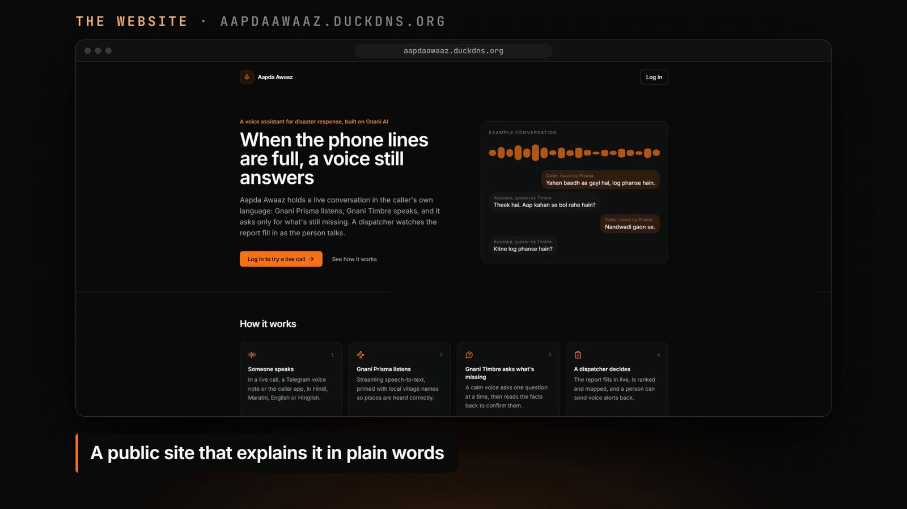
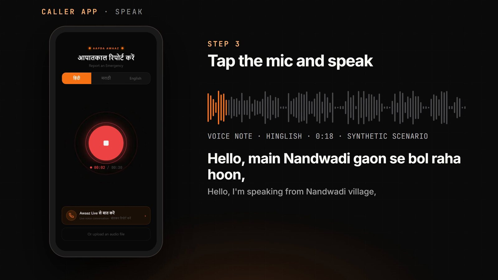
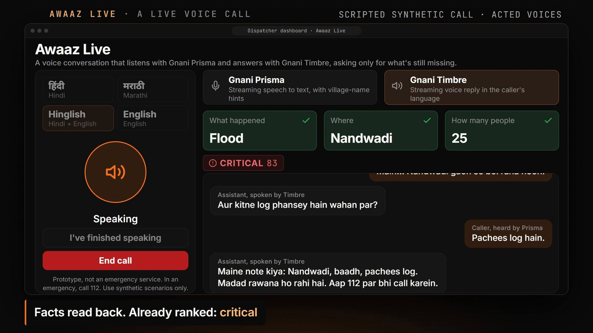
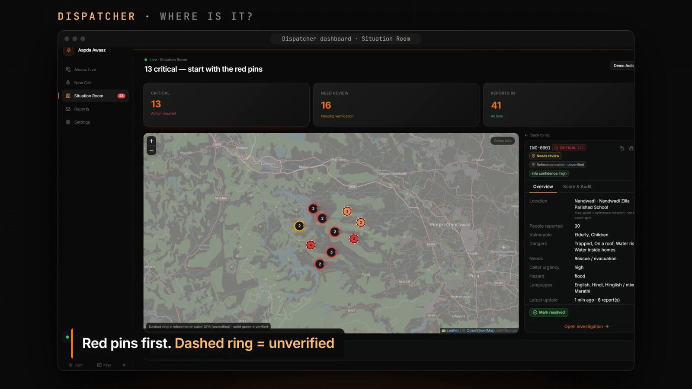
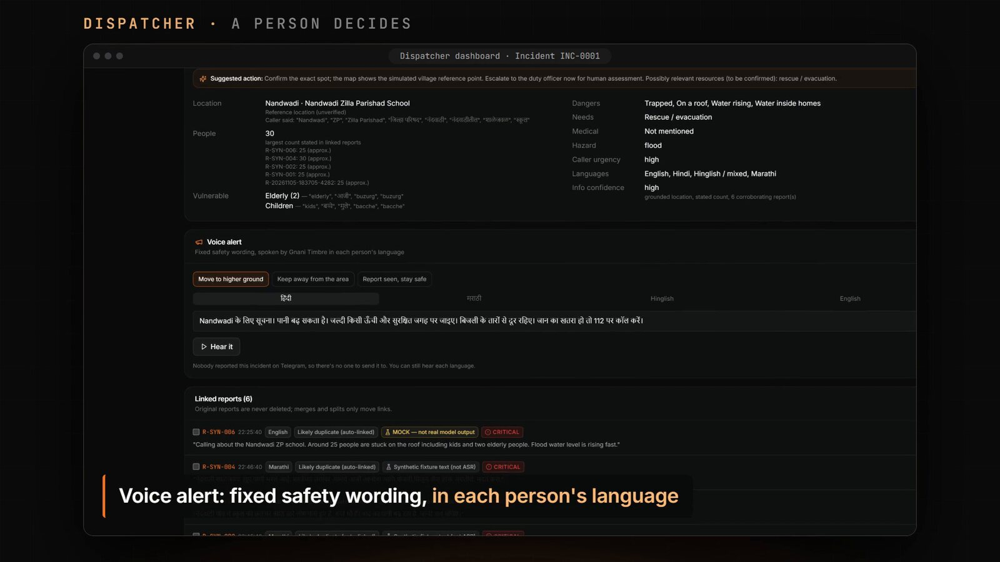
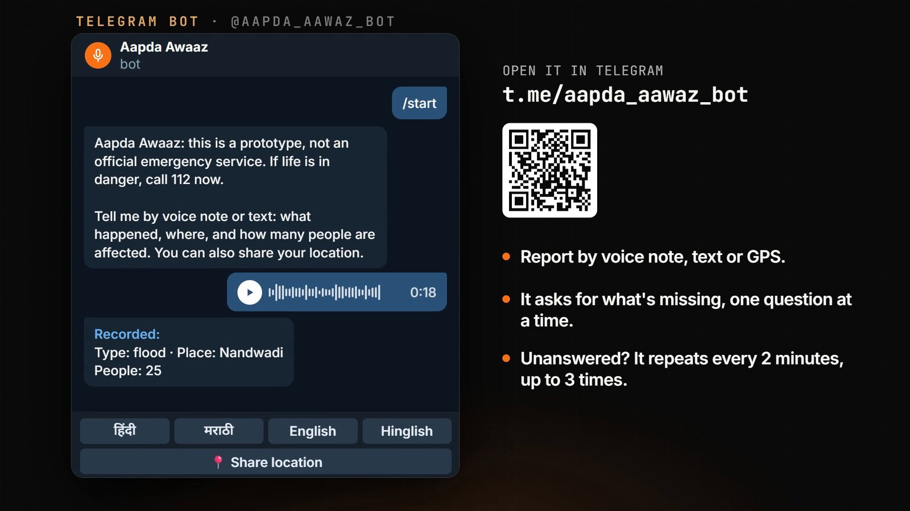
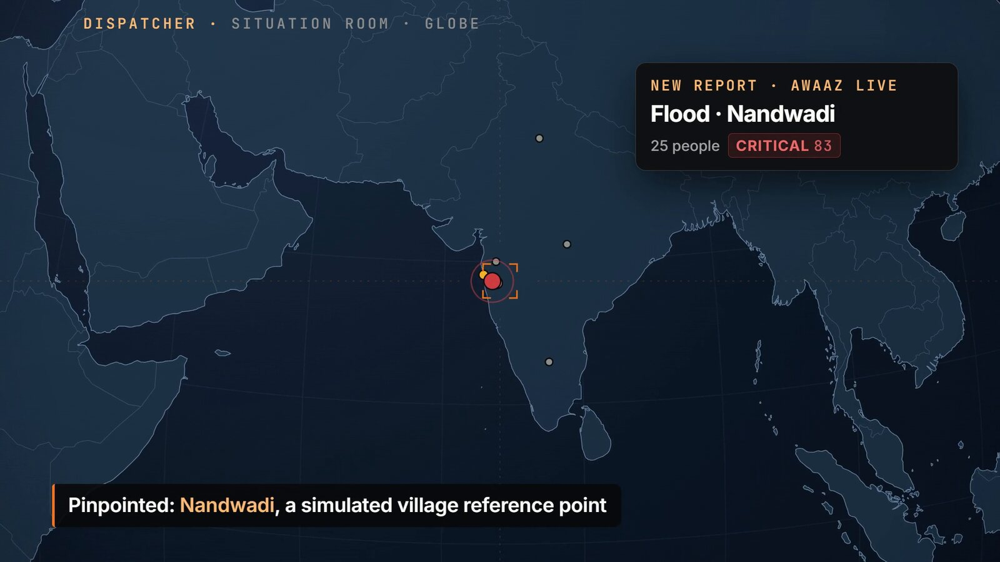
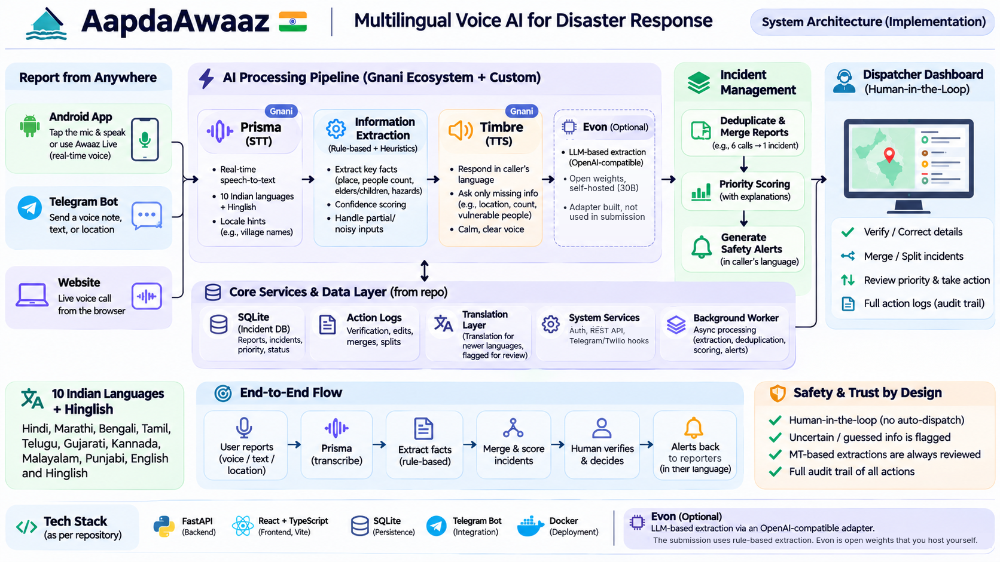

# Aapda Awaaz

**When the phone lines are full, a voice still answers.**

A multilingual voice assistant for disaster response, built on Gnani AI. People report an emergency in their own
language, the system sorts the chaos into clear incidents, and a human dispatcher always makes the call.

[](https://github.com/SarangRao20/AapdaAawaz/actions/workflows/ci-cd.yml)


**[Live site](https://aapdaawaaz.duckdns.org)** | **[Telegram bot](https://t.me/aapda_aawaz_bot)** | **[Android app](https://github.com/SarangRao20/AapdaAawaz/releases/latest)** | **[One-page pitch](PITCH.md)**



> **Prototype, synthetic data only, decision support.** Aapda Awaaz does not dispatch anyone, contact emergency
> services or promise help. Every action stays with a person. All reports, people and places in this repository are
> fictional. It is not a replacement for **112**.

## Contents

1. [The problem](#the-problem)
2. [What it does](#what-it-does)
3. [See it in action](#see-it-in-action)
4. [Architecture](#architecture)
5. [Built on Gnani](#built-on-gnani)
6. [Project structure](#project-structure)
7. [Run it yourself](#run-it-yourself)
8. [Features in detail](#features-in-detail)
9. [How well does it work?](#how-well-does-it-work)
10. [Safety and limitations](#safety-and-limitations)
11. [Deployment](#deployment)
12. [Tests](#tests) and [Troubleshooting](#troubleshooting)
13. [Team and license](#team-and-license)

## The problem

In a flood, emergency lines fill up. Callers are frightened, switch between languages, and many of them describe
the same school roof. Dispatchers end up with a pile of unstructured audio and have to decide, by ear and under
pressure, who gets help first.

## What it does

Aapda Awaaz turns those calls into a ranked, de-duplicated picture of what is happening and where.

- **Report from anywhere.** An Android app, a Telegram bot, or a live voice call in the browser.
- **10 Indian languages, plus Hinglish.** The caller speaks and is answered in the same language.
- **It asks only what is missing.** Where? How many people? Anyone vulnerable? One question at a time, by voice.
- **Duplicates collapse.** Six reports about one event become one incident, with the evidence shown.
- **A priority you can argue with.** Every score lists its reasons, and severity is kept separate from how sure the
  system is about the information.
- **Honest about uncertainty.** A shaky transcript or a guessed location is flagged for review and never shown as fact.
- **A person decides.** Dispatchers verify, correct, merge, split and send alerts, and every action is logged.

```
voice or text  ->  speech to text  ->  facts pulled out  ->  confidence gate
              ->  duplicates merged  ->  explainable priority  ->  dispatcher decides  ->  spoken alert
```

## See it in action

| | |
|---|---|
|  |  |
| **Caller app.** Tap the mic and speak, in your own language. | **Awaaz Live.** A realtime voice call that asks only for what is still missing. |
|  |  |
| **Command Center.** Red pins first, dashed rings are unverified. | **Incident page.** Facts, linked reports, and a voice alert in each person's language. |
|  |  |
| **Telegram bot.** Voice note, text or location. | **Situation Room.** A new report arrives and the globe turns to it. |

## Architecture



| Layer | What it does | Where it lives |
|---|---|---|
| Report channels | Android app, Telegram bot, and a live voice call on the website | `caller-app/`, `backend/app/services/telegram_bot.py`, `frontend/` |
| AI pipeline | Gnani Prisma (speech to text), rule-based fact extraction, Gnani Timbre (spoken replies) | `backend/app/providers/`, `backend/app/services/` |
| Incident management | De-duplication, merging, explainable priority score, safety alerts | `matching.py`, `priority.py`, `aggregation.py`, `voice_alerts.py` |
| Dispatcher dashboard | Map, queue, review, merge and split, audit trail | `frontend/` |
| Core services | SQLite, action logs, translation for the newer languages, auth, background worker | `models.py`, `worker.py`, `translate.py` |

Extraction, gating, priority and matching are pure, deterministic functions. That is what makes every score
explainable and every test repeatable. More detail is in [docs/ARCHITECTURE.md](docs/ARCHITECTURE.md) and
[docs/API.md](docs/API.md).

## Built on Gnani

| Gnani model | What we use it for |
|---|---|
| **Prisma v3.0** (speech to text) | Streams the caller's voice live, over REST and WebSocket. For Hindi, Marathi and English it also gets village names as hints, so "Nandwadi" is heard as Nandwadi. |
| **Timbre v3.0** (text to speech) | Speaks the questions, read-backs and safety alerts in the caller's language. |
| **Evon** (reasoning model) | An OpenAI-compatible adapter for self-hosting the open weights. The submission itself uses rule-based extraction. |

### Languages

| Language | Code | Fact extraction |
|---|---|---|
| Hindi, Marathi, English, Hinglish | `hi` `mr` `en` `mixed` | Hand-built rules |
| Bengali, Gujarati, Kannada, Malayalam, Punjabi, Tamil, Telugu | `bn` `gu` `kn` `ml` `pa` `ta` `te` | Read from a machine translation, **always flagged for human review** |

Prompts, questions and the three safety alerts are fixed text, written in advance for every language. They are never
machine-translated, because a wrong safety instruction is worse than none. The wording for the seven newer languages
has not been checked by native speakers yet, so please have one read it before real use.

## Project structure

```
AapdaAawaz/
├── backend/                 FastAPI service
│   ├── app/
│   │   ├── api/             routes: reports, incidents, live call, auth, system, twilio
│   │   ├── providers/       prisma, timbre, evon, streaming client, mock speech
│   │   ├── services/        extraction, gate, priority, matching, pipeline, live call,
│   │   │                    telegram bot, voice alerts, languages, translation, worker
│   │   ├── models.py        SQLAlchemy tables
│   │   └── main.py
│   ├── data/                simulated gazetteer, synthetic and hold-out reports, sample audio
│   ├── scripts/             manage.py (db tools), benchmark_stt.py
│   └── tests/               257 pytest tests
├── frontend/                React + TypeScript + Vite dashboard and live-call page
│   └── src/ (pages, components, lib)
├── caller-app/              React + Capacitor app for the public (web and Android)
├── mcp_server/              MCP tools so any AI agent can use the pipeline
├── deploy/                  Caddyfile and one-time VM setup
├── docs/                    architecture, API, safety, evaluation, limitations, images
├── .github/                 CI/CD workflow and the remote deploy script
├── docker-compose.yml       optional: run the API in a container
├── .env.example             every setting, with comments
├── PITCH.md                 the one-page pitch
└── run.sh, setup.ps1,       local run helpers (Linux/macOS and Windows)
    run-backend.ps1, run-frontend.ps1
```

## Run it yourself

You need **Python 3.11+** and **Node.js 18+**. Without a Gnani key it still runs, using a clearly labelled mock
speech-to-text that only recognises the bundled sample audio.

**Linux or macOS**

```bash
cd backend && python -m venv venv && venv/bin/pip install -r requirements.txt && cd ..
cp .env.example .env        # add GNANI_API_KEY for real speech
./run.sh                    # API on :8000, dashboard on :5173
```

**Windows**

```powershell
powershell -ExecutionPolicy Bypass -File setup.ps1
powershell -ExecutionPolicy Bypass -File run-backend.ps1     # terminal 1
powershell -ExecutionPolicy Bypass -File run-frontend.ps1    # terminal 2
```

Open http://127.0.0.1:5173. The API docs are at http://127.0.0.1:8000/docs.

### Configuration

Copy `.env.example` to `.env`. Real environment variables win over `backend/.env`, which wins over the root `.env`.

| Variable | Default | What it does |
|---|---|---|
| `GNANI_API_KEY` | empty | Turns on Prisma and Timbre. Never logged or returned by the API. |
| `STT_PROVIDER`, `TTS_PROVIDER` | `auto` | `auto` uses Gnani when a key is set, otherwise the mock |
| `EXTRACTION_PROVIDER` | `rules` | `rules` (offline) or `evon` (your own OpenAI-compatible Evon endpoint) |
| `PRISMA_MODEL`, `TIMBRE_MODEL` | `prisma-v3.0`, `timbre-v3.0` | Speech models. Timbre voices must match the model version. |
| `ADMIN_USERNAME`, `ADMIN_PASSWORD` | `admin`, empty | Dashboard login. With no password, nobody can log in. |
| `LIVE_PUBLIC` | `false` | Let the public caller app start live calls without a login |
| `COOKIE_SECURE` | `false` | Set to `true` once the dashboard is served over HTTPS |
| `CORS_ORIGINS` | local dev origins | An explicit list, no wildcard |
| `TELEGRAM_BOT_TOKEN` | empty | Starts the Telegram bot. Never commit it. |
| `AAPDA_VAR_DIR` | `backend/var` | SQLite database, uploads and generated audio |

Confidence-gate, de-duplication and priority thresholds live on the dashboard's **Settings** page and are stored in
the database. Everything else is explained in `.env.example`.

## Features in detail

### Awaaz Live

Open **Awaaz Live**, pick a language and press **Start call**. Prisma streams what you say, the assistant asks aloud
for whatever is still missing, reads the facts back, and saves a normal report. The Situation Room shows calls as
they happen. A call needs a microphone and either localhost or HTTPS. It is half duplex (the mic is ignored while
the assistant speaks) and stops after 5 minutes.

### Telegram bot

People report by voice note, text or GPS. The bot asks for each missing field one at a time, by text and by voice,
and repeats unanswered questions every `TELEGRAM_FOLLOWUP_INTERVAL_S` seconds, up to
`TELEGRAM_FOLLOWUP_MAX_ATTEMPTS` times. Create a bot with @BotFather, put the token in `.env`, restart, and send
`/start`. Anyone who finds the bot can use it unless you set `TELEGRAM_ALLOWED_CHAT_IDS`. Run only one copy per token.

### Voice alerts

On an incident page a dispatcher picks a fixed safety message. It goes out as text and a voice note to the people who
reported that incident on Telegram, each in their own language. A person always presses send.

### MCP server

`mcp_server/` exposes five tools (`submit_report`, `get_report`, `list_incidents`, `get_incident`,
`get_system_health`) over the Model Context Protocol. Run `mcp_server/setup.sh` to generate a Claude Desktop config.
It signs in with `API_TOKEN` from `.env`.

### 3D site view and Evaluation Lab

**3D Site** flies into a tilted satellite view of an incident and needs no key (add `VITE_GOOGLE_MAPS_API_KEY` for
Google's photorealistic tiles). The **Evaluation Lab** replays the pipeline on a development split and a hold-out
split and shows confusion matrices, precision and recall.

## How well does it work?

On the small **hold-out set of 12 synthetic reports**, which were written after the rules were frozen:

| Metric | Result |
|---|---|
| Location accuracy | 100% |
| Priority accuracy | 92% (11 of 12) |
| Medical-emergency recall | 100% (1 of 1) |
| People-count accuracy | 92% |
| Duplicate pairs, precision and recall | 100% and 100% (1 pair) |

These samples are tiny and synthetic, so read them as a sanity check and not a benchmark. The misses are published
in [docs/EVALUATION.md](docs/EVALUATION.md) instead of being tuned away. Speech-to-text results on clean,
phone-quality and noisy audio are in [docs/STT_BENCHMARK.md](docs/STT_BENCHMARK.md).

## Safety and limitations

Human oversight is part of the design. Possible duplicates are never merged automatically, every correction keeps the
original transcript and extraction plus an audit trail, and alerts never promise help. Please read
[docs/SAFETY.md](docs/SAFETY.md) and [docs/KNOWN_LIMITATIONS.md](docs/KNOWN_LIMITATIONS.md) before relying on
anything here.

## Deployment

```
git push to main
      |
GitHub Actions: backend tests, frontend typecheck and tests, caller-app lint and build
      |  (all green)
Azure VM: back up code and database, sync, restart the API, check /api/health, roll back on failure
      |
Caddy: HTTPS, serves the dashboard, proxies /api (WebSockets included)
      |
https://aapdaawaaz.duckdns.org
```

- **CI/CD** is in `.github/workflows/ci-cd.yml`. It runs on every push and pull request, and a green push to `main`
  deploys.
- **The deploy** snapshots the SQLite database and backs up the live code, syncs the new code (leaving `venv/`,
  `var/` and `.env` alone), restarts the `aapda-api` service and checks `/api/health`. If anything fails it restores
  the backup automatically.
- **One origin.** [Caddy](deploy/Caddyfile) serves the dashboard and proxies `/api` to the API with automatic HTTPS,
  so the browser never makes a cross-origin request. One-time VM setup: `bash deploy/setup-caddy.sh <your-domain>`.
- **Secrets** live in GitHub Actions: `VM_HOST`, `VM_USER`, `VM_SSH_KEY`, and optionally `VM_PORT`.
- `docker-compose.yml` and `backend/Dockerfile` are there if you would rather run the API in a container.

## Tests

```bash
cd backend && venv/bin/python -m pytest -q     # 257 tests
cd frontend && npm test && npm run build       # 5 tests, typecheck and production build
```

## Troubleshooting

| Symptom | Fix |
|---|---|
| "Backend unreachable" in the dashboard | Start the API on port 8000. The Vite dev server proxies `/api` to it (`VITE_API_TARGET` overrides). |
| Uploaded audio ends in "needs transcript" | Expected without `GNANI_API_KEY`: the mock only knows the bundled sample clips. Type the transcript on the report page. |
| "Accepts at most 30 s" | That is Prisma's per-request limit. Trim the clip. |
| The map is grey with a yellow banner | OpenStreetMap tiles could not load (offline). Markers still show. |
| `database is locked` on a CLI reset | Stop the API first, or use the Reset button in the UI. |

## Team and license

Built by **Sarang Gajanan Rao** and **Jainam Dudhediya** at Pune Institute of Computer Technology, for the Great
Indian AI Internship Challenge by Gnani AI.

Licensed under the [Apache License 2.0](LICENSE).
