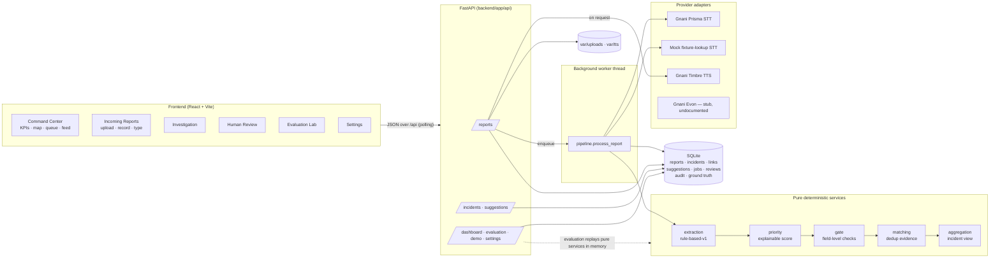

# Architecture

## Components and data flow

### Processing stages (one `ProcessingJob` row each)

| Stage | Provider | Mode | Notes |
|---|---|---|---|
| transcription | `gnani-prisma-v2.5` / `mock-fixture-lookup` / `synthetic_fixture` / `manual_entry` | real / mock / fixture / human | Skipped when a transcript already exists. Empty or unknown audio → `needs_transcript`, never invented text. Errors → `failed` with message; reprocess or type the transcript. |
| extraction | `rule-based-v1` | rule_based | Output validated by the Pydantic `ExtractionResult` model before storage. First extraction is kept immutable in `extraction_original`. |
| priority | `priority-rules-v1` | rule_based | Report-level score (incident score is recomputed on the aggregate). |
| confidence_gate | `gate-rules-v1` | rule_based | Field-level review reasons. |
| deduplication | `matching-rules-v1` | rule_based | Link to an incident or create one + duplicate suggestions. |

The worker is a single daemon thread fed by an in-process queue. Reports interrupted mid-processing
are re-queued at startup. All incident/link mutations take one process-wide lock, so a new report
can never create two incidents through a race between the worker and an API request.

## Design decisions

1. **Pure core, thin orchestration.** Extraction, gating, priority, matching and aggregation are pure
   functions over plain dicts/dataclasses. The DB pipeline and the evaluation replay call exactly the
   same code, so evaluation numbers describe the system that runs.
2. **Raw data separate from aggregates.** `reports` hold the transcript, raw provider output and the
   original + current extraction. `incidents` hold only the aggregate. `incident_links` connect them
   and are *deactivated*, never deleted, so merges/splits keep full history.
3. **Unknown is a first-class value.** `None` means "not stated". It is never coerced to 0, False or
   "safe" — in the schema, the aggregation, the priority engine, the UI and the evaluation.
4. **No geocoding of free text.** Coordinates come only from the *simulated* reference gazetteer when
   exactly one reference place is named, or from a dispatcher. Generic landmarks ("the big bridge"),
   unknown villages and multiple places stay off the map.
5. **Severity ≠ confidence.** Missing or uncertain information never lowers the priority score; it is
   reported as `missing_info` and routed to human review.
6. **Human corrections are overrides, not edits.** They live in `incidents.human_overrides` with an
   `audit_log` row (old → new, actor, note). Transcripts and AI extractions are never modified by review.
7. **Polling, not a fake live socket.** The UI polls every 2–4 s; the feed highlights reports that
   actually arrived since the previous poll.

## Extraction (rule-based-v1)

`services/extraction.py` + `services/lexicon.py` + `services/text_utils.py`.

* Normalisation: NFC, nukta/chandrabindu folding, Devanagari digits → ASCII, lower-case; clause-aware
  tokenisation (keywords never match across sentence/comma boundaries).
* Keyword syntax: `word` exact token, `word*` prefix (for Marathi/Hindi case suffixes), multi-word =
  consecutive tokens.
* Negation: a negator within 2 tokens after or 3 before (same clause) cancels dangers, vulnerable
  mentions, urgency and status claims (e.g. "कोई घायल नहीं", "no one is hurt"). Needs are **not**
  negated ("दवाई नहीं मिली" = medicine needed).
* People count: number (digit or number word) + up to one filler token + people noun; ranges use the
  upper bound; approximators set `approximate`; families are recorded separately and never converted;
  ages ("72 साल") mark elderly/children instead of counts; vague quantities ("बहुत सारे लोग") stay unknown.
* Location: see decision 4. Statuses: `grounded`, `landmark_only`, `ambiguous`, `conflicting`,
  `unmapped`, `missing`.

### Rule-evidence levels (not probabilities)

| Location | Level | People count | Level |
|---|---|---|---|
| reference place + landmark | 0.90 | explicit | 0.85 |
| reference place only | 0.80 | approximate | 0.70 |
| landmark only (specific) | 0.50 | range / several different counts | 0.60 |
| caller-named place not in reference | 0.40 | none / vague / families only | 0.00 |
| ambiguous / conflicting | 0.20 | low-quality transcript cap | 0.40 |
| missing | 0.00 | | |
| low-quality transcript cap | 0.60 | | |

## Confidence gate

Report-level reasons (`services/gate.py::assess`): `location_missing|ambiguous|conflicting|unmapped|landmark_only|low_confidence`,
`people_count_unknown` (only when the report's priority ≥ `unknown_people_review_at`, default *high*),
`people_count_low_confidence`, `low_quality_transcript`, `urgency_unclear` (no urgency **and** no
danger/need/status at all), `inconsistent_fields` (says "safe" but describes a threat to life; several hazards).

Incident-level reasons (`gate.incident_reasons`) are evaluated on the **aggregate**, so a report that
did not state a count does not keep an incident flagged once another report states it:
ungrounded location, unknown count at high priority, *all* transcripts low quality, unacknowledged
contradictions between reports, pending duplicate suggestions, nothing identifiable.

Review status: `needs_review` → (dispatcher marks reviewed) → `reviewed`; new reports with flags or
new suggestions after the review → `rereview_needed`; `no_review_required` when nothing is flagged.

## Duplicate detection

`services/matching.py`. A report profile is scored against every active incident profile.

| Feature | Weight | | Feature | Weight |
|---|---|---|---|---|
| same reference place | +0.50 | | same landmark | +0.25 |
| different reference place | −0.60 | | different landmark | −0.40 |
| place is one of the other side's candidates | +0.20 | | landmark type overlap | +0.10 |
| same unmapped place name | +0.35 | | same hazard | +0.15 |
| different unmapped place name | −0.30 | | different hazard | −0.35 |
| verified coords ≤ 0.5 km | +0.50 | | fact overlap (Jaccard × 0.2) | ≤ +0.20 |
| verified coords ≥ 5 km | −0.60 | | no shared facts | −0.15 |
| same people count (±20%) or families | +0.10 | | outside 360-min window | −0.50 |
| transcript trigram similarity × 0.1 | ≤ +0.10 | | | |

*Facts* = dangers ∪ needs ∪ vulnerable groups ∪ {medical emergency, critical medication}.

Outcomes: score ≥ 0.70 → **likely duplicate** (auto-link) unless capped; score ≥ 0.40 → **possible
duplicate** (separate incident + `duplicate_suggestions` row for a human); otherwise **distinct**.
A likely match is **capped to possible** when there is any contradiction (people counts differ ×2+,
safe vs threat-to-life, different hazards), when either location is not grounded, or when the new
report's transcript is low quality. Every feature and cap is stored as evidence and shown in the UI.

## Priority scoring

`services/priority.py`, weights in `services/settings_store.py` (editable thresholds on Settings).

| Factor | Points | Factor | Points |
|---|---|---|---|
| explicit threat to life (trapped, surrounded by water, on roof, swept away, drowning, under debris, unconscious, active fire, missing person) | 55 | rescue / evacuation requested | 20 |
| medical emergency described (labour, unconscious, burns, snakebite, breathing, bleeding…) | 45 | basic needs (food, drinking water, shelter) | 12 |
| injuries | 25 | medical help requested | 10 |
| critical medication (insulin, oxygen, dialysis) | 25 | escalating hazard (water rising, inside homes, collapse) | 10 |
| vulnerable group explicitly mentioned | 6 each, max 18 | 25+ / 10+ people stated | 10 / 5 |
| caller urgency critical / high / medium | 10 / 6 / 2 | road blocked | 3 |

Labels: **critical ≥ 55**, **high ≥ 25**, **medium ≥ 10**, else low. If callers say everyone is
safe/evacuated and nothing acute is reported, the label is capped at *medium*. A dispatcher can set
the label explicitly; the computed label stays visible. The queue sorts by label, then score.

These weights are prototype defaults chosen against synthetic data. They are **not** an operationally
or clinically validated triage algorithm and do not decide rescue order.

## Information confidence (incident)

Ordinal, rule-based: **low** if the location is ambiguous/unmapped/unknown, there are contradictions,
or every transcript is low quality; **high** if the location is reference-matched or verified, the
count is stated, and there are ≥ 2 corroborating reports (or the location is verified); otherwise
**medium**. Shown next to — never mixed into — severity.

## Data model (SQLite)

`reports`, `audio_files`, `incidents`, `incident_links`, `duplicate_suggestions`, `processing_jobs`,
`review_records`, `audit_log`, `ground_truth`, `acknowledgements`, `app_settings`, `evaluation_runs`.
Schema is created by `init_db()` (idempotent `create_all`; a `schema_version` row is recorded).
Foreign keys and WAL mode are enabled.
